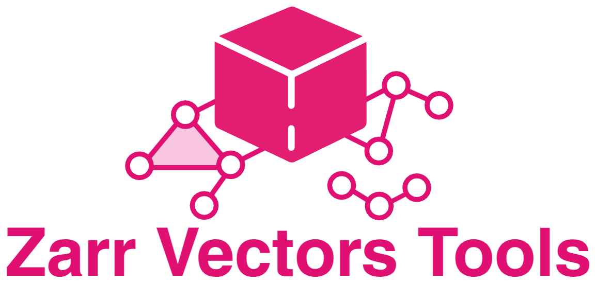

> [!NOTE]
> This package is under development; its API can change.



# zarr-vectors-tools

Convert neuroscience geometry (point clouds, single-cell tables, tractography,
skeletons, meshes, cortical surfaces, graphs) into
[Zarr Vectors](https://alleninstitute.github.io/zarr_vectors/) stores and back,
build multiresolution pyramids for viewing, and run algorithms over stores too
large to load at once.

It extends [zarr-vectors-py](https://github.com/AllenInstitute/zarr-vectors-py),
which owns the format and its core Python API. Zarr Vectors was specified by
Forrest Collman at the Allen Institute for Brain Science.

**Documentation:** <https://zarr-vectors-tools.readthedocs.io/en/latest>

## Install

```bash
pip install zarr-vectors-tools                 # CSV, tables, lines, SWC, OBJ, STL
pip install "zarr-vectors-tools[all]"          # every reader and writer
```

Python 3.11 or later. The
[install guide](https://zarr-vectors-tools.readthedocs.io/en/latest/install.html)
lists the extras.

## Quick start

```bash
# A table of points -> a store with two coarser levels
zvtools convert cells.csv cells.zv --chunk-shape 100,100,100 --bin-shape 10,10,10 \
    --coarsen 2,2 --sparsity 1,1 --cross-level-storage none
zvtools validate cells.zv

# A store -> a file
zvtools convert cells.zv cells_out.csv

# View a TRK file in Neuroglancer without converting it
zvtools virtual serve tracts.trk
```

The same conversion from Python:

```python
from zarr_vectors_tools.convert.ingest.csv_points import ingest_csv
from zarr_vectors_tools.multiresolution.coarsen import build_pyramid

ingest_csv("cells.csv", "cells.zv", (100.0, 100.0, 100.0), bin_shape=(10.0, 10.0, 10.0))
build_pyramid("cells.zv", factors=[(2, 1), (2, 1)], cross_level_storage="none")
```

## Development

```bash
git clone https://github.com/AllenInstitute/zarr-vectors-tools
cd zarr-vectors-tools
pip install -e ".[all,dev]"
pytest -m "not slow" -n auto      # fast tier; plain `pytest` runs everything
pip install -r docs/requirements-docs.txt
python -m sphinx -b html docs docs/_build/html
```

## License

BSD-3-Clause.
