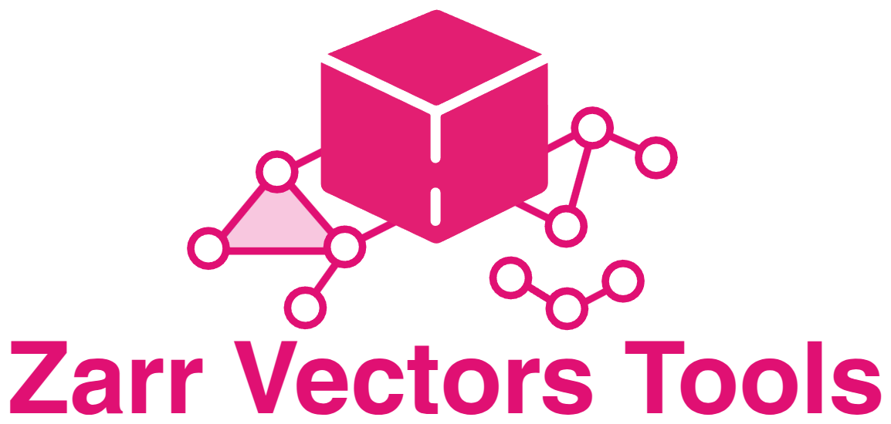

> [!NOTE]
> This package is under development and will change. It will also be migrated to another location once completed.



# zarr-vectors-tools

Convert neuroscience geometry (point clouds, single-cell tables, tractography,
skeletons, meshes, cortical surfaces, graphs) into
[Zarr Vectors](https://alleninstitute.github.io/zarr_vectors/) stores and back,
build multiresolution pyramids for viewing, and run algorithms over stores too
large to load at once.

It extends [zarr-vectors-py](https://github.com/AllenInstitute/zarr-vectors-py),
which owns the format and its core Python API
([docs](https://zarr-vectors-py.readthedocs.io/en/latest)). Zarr Vectors was
originally specified by Forrest Collman at the Allen Institute for Brain Science.

**Documentation:** <https://zarr-vectors-tools.readthedocs.io/en/latest>

## Install

```bash
pip install zarr-vectors-tools                 # CSV, tables, lines, SWC, OBJ, STL
pip install "zarr-vectors-tools[trk]"          # + TRK and TCK (nibabel)
pip install "zarr-vectors-tools[all]"          # every reader and writer
```

Python 3.11 or later. The other extras are listed in the
[install guide](https://zarr-vectors-tools.readthedocs.io/en/latest/install.html).

## Quick start

```bash
# A table of points -> a store with two coarser levels
zvtools convert cells.csv cells.zv --chunk-shape 100,100,100 --bin-shape 10,10,10 \
    --coarsen 2,2 --sparsity 1,1 --cross-level-storage none
zvtools info cells.zv
zvtools validate cells.zv

# A store -> a file: the direction comes from the input
zvtools convert cells.zv cells_out.csv
```

The same from Python:

```python
from zarr_vectors_tools.convert.ingest.csv_points import ingest_csv
from zarr_vectors_tools.multiresolution.coarsen import build_pyramid

ingest_csv("cells.csv", "cells.zv", (100.0, 100.0, 100.0), bin_shape=(10.0, 10.0, 10.0))
build_pyramid("cells.zv", factors=[(2, 1), (2, 1)], cross_level_storage="none")
```

Choosing chunk, bin and pyramid values is covered in
[Store layout](https://zarr-vectors-tools.readthedocs.io/en/latest/store_layout.html)
and [Pyramids](https://zarr-vectors-tools.readthedocs.io/en/latest/pyramids.html).
To view a store, see
[Visualise](https://zarr-vectors-tools.readthedocs.io/en/latest/visualise.html).

## What's in it

| Module | Purpose |
| --- | --- |
| `convert.ingest`, `convert.export` | readers and writers for CSV, LAS/LAZ, PLY, h5ad, delimited tables, line CSV, TRK, TCK, TRX, SWC, OBJ, STL, GraphML, edge lists, GIFTI, FreeSurfer, CIFTI and Neuroglancer precomputed |
| `multiresolution` | pyramid building for every geometry |
| `compose` | merging stores and files into a store, and splitting one apart |
| `algorithms` | graph search, components and clustering; mesh summaries and queries; streamline, skeleton and parcel summaries |
| `headers` | format headers kept for round-trip export |
| `virtual` | tractograms read as zarr-vectors stores without converting them, and served over HTTP (`zvtools virtual serve`) |
| `cli` | the `zvtools` command line |

## Virtual stores

`zarr_vectors_tools.virtual` reads a tractogram (TrackVis `.trk`, MRtrix
`.tck`, `.trx`) as a zarr-vectors store without converting it: the file is
read once and binned into cells, and every key is made when asked. The
stores are valid 0.9.2 stores, and the same, chunk for chunk, as the ones
ngplatform makes in the browser from local files.

```bash
zvtools virtual serve tracts.trk    # http://127.0.0.1:8000/tracts.trk/|zarr-vectors:
```

```python
from zarr_vectors_tools.virtual import open_virtual
store = open_virtual("tracts.trk")
store.get("zarr.json"); store.list("0/object_attributes/")
```

## Development

```bash
git clone https://github.com/AllenInstitute/zarr-vectors-tools
cd zarr-vectors-tools
pip install -e ".[all,dev]"
pytest -m "not slow" -n auto      # fast tier; plain `pytest` runs everything
```

Build the docs:

```bash
pip install -r docs/requirements-docs.txt
python -m sphinx -b html docs docs/_build/html
```

## License

BSD-3-Clause.
